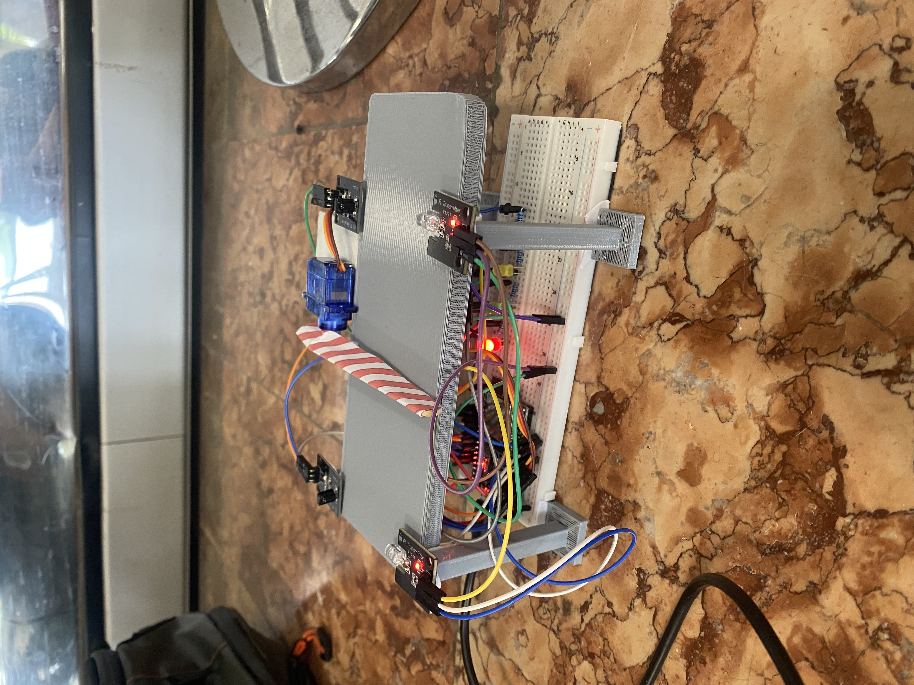

# ParkSecured Web — Smart Access Control & Attendance Dashboard

Web dashboard for **ParkSecured** administration, real-time gate monitoring, employee & division management, audit logs, and attendance reporting.

## Live Deployment & Documentation
* **Web Dashboard (Frontend):** [https://park-secure-vrxr.onrender.com/](https://park-secure-vrxr.onrender.com/)
* **Cloud REST API:** `https://park-secured-cloud-r62j.onrender.com/api`
* **API Documentation (Swagger):** [https://park-secured-cloud-r62j.onrender.com/api/docs](https://park-secured-cloud-r62j.onrender.com/api/docs)
* **Full Project Presentation (PDF):** [View Architecture & Business Deck](./docs/E52_PRE_07_06_2026.pdf)

> **Note:** The web dashboard communicates exclusively with the cloud backend (`park-secured-cloud`) over HTTPS/REST using JWT authentication. The legacy `backend/` directory is kept for historical/compatibility reference only.

---

## System Demo & Hardware Prototype

In the demo below, the physical **ESP32-powered barrier prototype** (equipped with dual IR safety sensors, servo actuator, and status LEDs) interacts in real time with the **MobileID app (BLE)** and the **Web/Operator Dashboard**:
1. Employee requests access via smartphone (BLE).
2. Out-of-hours / exception requests trigger an instant approval popup on the Operator Web Dashboard, updating access permissions in real time.
3. Barrier opens (`LED Green`), tracks vehicle passage via infrared beams (`LED Blue` anti-impact safety state), and closes automatically (`LED Red`), logging the event to PostgreSQL.

### End-to-End Live Demo (Mobile BLE + Web Dashboard + ESP32 Gate)
<video src="./docs/demo.mp4" controls="controls" style="max-width: 730px;"></video>

### Physical Gate Prototype (ESP32 + IR Sensors + Servo)


---

## System Architecture

ParkSecured is a full-stack, multi-platform IoT ecosystem structured across four decoupled layers:
* **Edge Layer (Embedded):** ESP32 microcontroller running a deterministic Finite State Machine (FSM) for barrier actuation, infrared anti-impact safety (< 0.1s loop), and local offline event caching.
* **Mobile Client:** Android/iOS app (React Native / Expo) for proximity access via Bluetooth Low Energy (BLE GATT) and personal attendance tracking.
* **Web & Operator Clients:** React + Vite administrative/HR portal and Tauri v2 desktop operator terminal.
* **Cloud Layer:** Node.js (Express) REST API with JWT rotation and normalized PostgreSQL (3NF) relational database.

---

## Key Web Dashboard Features

* **Role-Based Access Control (RBAC):** Dedicated workflows for System Admins, HR/Division Managers, and Gate Operators.
* **Real-Time Gate Monitoring:** Live visual barrier state (`Open`, `Closed`, `IR Safety`), ESP32 connection status, and instant operator override/approval modals for exception requests.
* **Employee & Division Management:** CRUD operations for employees, badge codes, vehicle plates, time-window access schedules, and organizational divisions.
* **Device Change Request Review:** Security workflow to approve or reject employee smartphone binding changes.
* **Audit Logs & CSV Export:** Filterable entry/exit history (`ALLOWED` / `DENIED`, BLE vs. manual source) with one-click `.csv` attendance export via the Cloud API.

---

## Tech Stack (Web Client)

* **Frontend:** React, Vite, JavaScript/TypeScript, Modern CSS
* **Authentication & Networking:** Asynchronous HTTP Client with automatic `Bearer <JWT>` header injection
* **Deployment:** Render Cloud

---

## Local Development

### Prerequisites
* Node.js (v18+ recommended)
* npm

### Installation & Run
```bash
cd frontend
npm install
npm run dev
```

### Environment Variables (Optional)
To point the frontend to a custom or local API instance, create a `.env` file inside `frontend/`:
```env
VITE_API_BASE_URL=[https://park-secured-cloud-r62j.onrender.com/api](https://park-secured-cloud-r62j.onrender.com/api)
```

### Production Build
```bash
cd frontend
npm run build
```

---

## Project Context & Team
Developed as an end-to-end engineering project by **Team E52** (from business analysis and UML/database design to hardware prototyping and acceptance testing).
* **Related Repositories:** `park-secured-mobile` | `park-secured-embedded` | `park-secured-cloud`